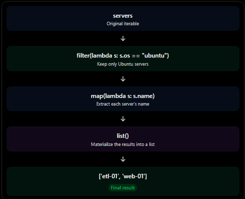

# 06. Sequences I: Architecture, Memory Formats, and Comprehensions

This document synthesizes advanced data structures in Python, focusing on internal memory layout, mutability boundaries, and functional transformations.

---

## 🏗️ 1. Sequence Classification Matrix

### Container Sequences vs Flat Sequences
* **Container Sequences:** Hold references to the objects they contain, which can be of any type (including other containers). Examples: `list`, `tuple`, `collections.deque`. They store arrays of pointers.
* **Flat Sequences:** Physically store the value of each item directly in their own sequential memory layout, not as distinct Python objects. Examples: `str`, `bytes`, `array.array`. They are more compact and memory-efficient but restricted to primitive atomic types.

### Mutable vs Immutable Sequences
* **Mutable:** `list`, `bytearray`, `array.array`, `collections.deque`.
* **Immutable:** `tuple`, `str`, `bytes`.

---

## ⚡ 2. Transformation Paradigms: Comprehensions vs Functional

### List Comprehensions `[x for x in ...]`
* The explicit Pythonic standard for mapping and filtering data.
* **Performance:** Operates at C-speed internal loop bytecode execution. It avoids the overhead of explicit function calls per element.

### Functional Constructs: `map`, `filter`, and `lambda`
* **`map(func, iterable)` / `filter(pred, iterable)`:** Return lazy evaluators (iterators). They do not compute values in memory until requested.
* **`lambda`:** Anonymous, single-expression functions. 
* *Note on Style:* While powerful for lazy streaming pipeline scenarios, standard list comprehensions are preferred for immediate memory list generation due to improved readability and type inspection inference.


---

# Sequences I

## Types of sequences and list comprehensions

- Container vs. flat sequences
- Mutable vs. immutable sequences
- List comprehensions: `[x for x in ...]`
- `map()`, `filter()`, and `lambda`

## What is a sequence?

A sequence is an ordered collection of elements in which each element has a specific position (index). Sequences allow you to access elements by their index and iterate over them.

```python
names = ["David", "Bender", "Sora"]

print(names[0])  # David
print(names[1])  # Bender
print(names[2])  # Sora
```

This is a sequence because:

- Ordered: Elements maintain a specific order.
- Indexed: Each element has a position, starting at index `0`.
- Accessible: You can retrieve elements using their indexes.
- Iterable: You can iterate over the elements using a `for` loop.

## Python sequences

### Two ways to classify sequences

Python sequences can be classified from two different perspectives:

1\. Based on what they store

This describes how elements are represented and stored in memory.

- Container: Stores references to other Python objects.
- Flat: Stores elements directly in a compact memory block, using a consistent representation.

2\. Based on whether they can be modified

This describes whether the contents of a sequence can be changed after creation.

- Mutable: Elements can be added, removed, or modified (depending on the sequence type).
- Immutable: The sequence cannot be modified after creation.

## Based on what they store

### Container vs. flat sequences

The main question is: How does Python represent the elements inside a sequence in memory?

| Type      | What does it store?                                                                   | Examples                                   |
| --------- | ------------------------------------------------------------------------------------- | ------------------------------------------ |
| Container | References (pointers) to other Python objects. Each element can be a different type.  | `list`, `tuple`, `collections.deque`       |
| Flat      | Elements stored directly in a compact memory block using a consistent representation. | `str`, `bytes`, `bytearray`, `array.array` |

Container sequences

A container sequence stores references to separate Python objects rather than storing their actual values directly.

```python
items = [10, "Hello", 3.14, True]
```

Each element can be a different data type because the list stores references to individual Python objects.

Flat sequences

A flat sequence stores its elements directly in a compact memory block. Its elements share a consistent representation, making storage more memory-efficient for certain types of data.

```python
numbers = [10, 20, 30]  # A regular list (container)

from array import array

numbers = array("i", [10, 20, 30])  # A flat sequence
```

Here, `array("i", ...)` stores integers using a consistent numeric representation rather than references to separate Python integer objects.

Important distinction: Container vs. flat describes memory representation, not whether a sequence is mutable or immutable. These are independent classifications.

---

## Container sequences

### Container sequences: A list of references

A container sequence stores references to other Python objects, rather than storing the actual objects directly inside its structure.

```python
components = [server, "ubuntu", 22.04, None]

print(components)
# [Server(etl-01, ubuntu 22.04, 2 services), 'ubuntu', 22.04, None]
```

Notice that we are mixing different data types:

- `server`: A custom Python object.
- `"ubuntu"`: A string (`str`).
- `22.04`: A floating-point number (`float`).
- `None`: A `NoneType` object.

This is possible because a list stores references (pointers) to Python objects in memory.

Each element can point to an object of a completely different type. This is why lists are flexible and can contain heterogeneous data.

Key idea: A list stores references to objects, not the objects themselves.

## Flat sequences

### Flat sequences: Storing values directly

Now, imagine we want to store the open ports of that same server.

Instead of using a regular list, we can use `array.array` to store numeric values in a more compact format.

```python
from array import array

ports = array("H", [22, 80, 443, 5432])

ports.append(8080)

print(ports)
# array('H', [22, 80, 443, 5432, 8080])
```

Unlike a regular list, an array requires its elements to follow a compatible data type and representation.

In this example, `"H"` represents an unsigned short integer, which typically occupies 2 bytes.

Its range is:

$$0 \leq x \leq 65,535$$

This means:

- `ports.append(8080)` → Valid.
- `ports.append("ssh")` → `TypeError`, because a string cannot be interpreted as an integer.
- `ports.append(70000)` → `OverflowError`, because the value exceeds the maximum allowed range.

A flat array stores its values directly in a compact memory block, using the same representation for every element.

Key idea: Flat sequences are generally more memory-efficient when storing large collections of compatible values.

## Why should this matter to us?

### Because of memory efficiency

The difference between container and flat sequences becomes especially important when working with large datasets.

Let's compare the memory consumption of a list and an array containing 65,536 integers.

```python
import sys
from array import array

numbers_list = list(range(65_536))
numbers_array = array("H", range(65_536))

print(sys.getsizeof(numbers_list))
print(sys.getsizeof(numbers_array))
```

How does memory usage differ?

1. List references: A list stores a reference to each element. On a typical 64-bit Python implementation, each reference occupies 8 bytes. For 65,536 elements, that's 524,288 bytes just for the references, excluding the actual integer objects.
2. Separate integer objects: Each integer is a separate Python object in memory. The list only stores references pointing to those objects. Therefore, the total memory consumption is higher than the size of the list itself.
3. Array values: The `array("H")` stores each integer directly using 2 bytes. For 65,536 elements, the actual data occupies 131,072 bytes, plus a small amount of object overhead.

Important: `sys.getsizeof()` reports the size of an object itself, not the total memory consumed by all objects it references. Therefore, comparing these two results alone does not measure the complete memory footprint of a list and its elements.

The main advantage of flat sequences is that they avoid the overhead of storing a separate Python object for every element.

## Based on whether they can be modified

### Mutable vs. immutable sequences

Now, let's change our perspective.

Instead of asking how Python stores the elements, we ask:

Can we modify a sequence after it has been created?

There are two categories: mutable and immutable.

### Mutable sequences

A mutable sequence is one whose contents can be changed after creation.

You can typically:

- Add new elements.
- Remove existing elements.
- Modify elements using their indexes.

Common examples:

- `list`
- `array.array`
- `bytearray`
- `collections.deque`

Example:

```python
nums = [10, 20, 30]

nums.append(40)  # Add an element
nums[0] = 100    # Modify an element

print(nums)
# [100, 20, 30, 40]
```

The original list is modified directly. We don't need to create a new list to apply these changes.

### Immutable sequences

An immutable sequence is one whose contents cannot be changed after creation.

Once created, you cannot:

- Add elements.
- Remove elements.
- Replace existing elements.

Common examples:

- `tuple`
- `str`
- `bytes`

Example:

```python
nums = (10, 20, 30)

nums[0] = 100
# TypeError: 'tuple' object does not support item assignment
```

Python raises an error because tuples do not allow their elements to be reassigned.

If you need different contents, you must create a new tuple.

Important: Immutable does not necessarily mean that everything inside the sequence is immutable. For example, a tuple can contain a mutable list. You cannot replace the list inside the tuple, but you can modify that list's contents.

```python
items = ([10, 20], "Python")

items[0].append(30)  # Valid

print(items)
# ([10, 20, 30], 'Python')
```

Key distinction:

| Classification | Meaning                                             | Examples                           |
| -------------- | --------------------------------------------------- | ---------------------------------- |
| Container      | Stores references to Python objects.                | `list`, `tuple`                    |
| Flat           | Stores values directly in a compact representation. | `str`, `bytes`, `array.array`      |
| Mutable        | Contents can be modified.                           | `list`, `array.array`, `bytearray` |
| Immutable      | Contents cannot be modified.                        | `tuple`, `str`, `bytes`            |

These classifications describe two independent characteristics: how elements are stored and whether the sequence can be modified.

---

## How the two classifications relate

### The two classifications are independent

A sequence can be classified using both characteristics at the same time:

1. Container vs. flat: Describes how elements are stored in memory.
2. Mutable vs. immutable: Describes whether the sequence can be modified after creation.

These classifications are independent, meaning that being a container does not determine whether a sequence is mutable or immutable.

Examples:

| Sequence      | Storage type | Mutability |
| ------------- | ------------ | ---------- |
| `list`        | Container    | Mutable    |
| `tuple`       | Container    | Immutable  |
| `array.array` | Flat         | Mutable    |
| `str`         | Flat         | Immutable  |
| `bytes`       | Flat         | Immutable  |
| `bytearray`   | Flat         | Mutable    |

For example:

- A `tuple` is a container because it stores references to other Python objects. However, it is immutable because its elements cannot be reassigned or its structure modified.
- An `array.array` is flat because it stores values directly using a consistent data representation. However, it is mutable because you can add, remove, or modify its elements.

> Remember these two questions:
>
> - Container vs. flat: How are the elements stored?
> - Mutable vs. immutable: Can the sequence be modified?

## List comprehensions

### The problem

Suppose we want to retrieve the names of all Ubuntu servers from a collection called `servers`.

We could use a traditional `for` loop:

```python
ubuntu_names = []

for server in servers:
    if server.os == "ubuntu":
        ubuntu_names.append(server.name)

print(ubuntu_names)
# ['etl-01', 'web-01']
```

This works perfectly, but there are a few things worth noticing:

- We create an empty list before starting the loop.
- We use `append()` to add each matching server name.
- The filtering condition and the transformation are spread across multiple lines.
- We need to read the entire loop to understand what the resulting list contains.

For a simple operation like this, Python offers a more concise alternative: list comprehensions.

## What is a list comprehension?

### An expression that creates a new list

A list comprehension is a concise way to create a new list from an existing iterable. It allows you to transform elements and optionally filter them based on a condition.

Instead of writing a traditional loop, we can express the same logic in a single statement:

```python
ubuntu_names = [
    server.name
    for server in servers
    if server.os == "ubuntu"
]

print(ubuntu_names)
# ['etl-01', 'web-01']
```

A list comprehension has three main parts:

| Part                 | Example                    | Purpose                                         |
| -------------------- | -------------------------- | ----------------------------------------------- |
| Expression           | `server.name`              | Determines what value is added to the new list. |
| Iteration            | `for server in servers`    | Defines where the elements come from.           |
| Condition (optional) | `if server.os == "ubuntu"` | Determines which elements are included.         |

How does it work?

1. Python iterates over `servers`.
2. Each element is temporarily assigned to `server`.
3. The `if` condition checks whether the server runs Ubuntu.
4. If the condition is true, `server.name` is evaluated and added to the new list.
5. If the condition is false, that element is skipped.

The result is a new list containing only the names of Ubuntu servers.

## List comprehensions

### If it fits on one line, keep it on one line

List comprehensions can be written on a single line when the expression is simple and easy to read.

```python
ubuntu_names = [s.name for s in servers if s.os == "ubuntu"]

print(ubuntu_names)
# ['etl-01', 'web-01']
```

It is also common to use shorter variable names, such as `s` instead of `server`, especially when the expression is straightforward.

However, readability should always come first. For more complex expressions, multiple lines are perfectly acceptable.

### Using object attributes and methods

The expression inside a list comprehension can contain any valid Python expression, including:

- Object attributes.
- Built-in functions.
- Method calls.
- Mathematical operations.
- Custom functions.

For example, suppose each server object implements the `__len__()` special method.

We can call `len()` directly:

```python
server_lengths = [len(s) for s in servers]

print(server_lengths)
# [2, 1, 3, 0]
```

Here is what happens:

- `len(s)` calls the server object's `__len__()` method.
- The returned value is added to the new list.
- This operation is repeated for every server.

Remember: You don't need to call special methods directly. Python automatically invokes them through their corresponding built-in operations. For example, `len(s)` invokes `s.__len__()`.

## Always results in a list

### The output is always a list

One important characteristic of list comprehensions is that they always produce a new Python list, regardless of the iterable used as their input.

For example, imagine we have an array containing server ports:

```python
from array import array

ports = array("H", [22, 80, 443, 5432, 8080])

privileged = [p for p in ports if p < 1024]

print(privileged)
# [22, 80, 443]

print(type(privileged).__name__)
# list
```

Notice the difference:

- `ports` is an `array.array` (a flat, mutable sequence).
- `privileged` is a `list` (a container, mutable sequence).

Even though we started with an array, the list comprehension created a regular Python list.

Key takeaway: A list comprehension always creates a new `list`. It does not preserve the original iterable's type.

---

## List comprehensions vs. `map()` and `filter()`

### `map()`: Transforming elements

The built-in `map()` function applies a given function to every element in an iterable and returns an iterator containing the results.

Syntax:

```python
map(function, iterable)
```

Example:

```python
def name_of(server):
    return server.name

names = map(name_of, servers)

print(names)
# <map object at 0x...>

print(list(names))
# ['etl-01', 'db-01', 'web-01', 'bi-01']
```

How does it work?

1. `map()` receives a function (`name_of`) and an iterable (`servers`).
2. It applies `name_of()` to each server.
3. Each function call returns the server's name.
4. `map()` produces an iterator that generates these results when requested.
5. `list()` consumes the iterator and creates a list containing all the results.

Important: Pass the function, not the result of calling it.

```python
map(name_of, servers)    # Correct
map(name_of(), servers)  # Incorrect
```

Why?

When we write `map(name_of, servers)`, we pass the function itself as an argument. We are telling `map()` which function to execute for each element.

However, when we write `map(name_of(), servers)`, Python tries to execute `name_of()` immediately, before `map()` receives it.

Since `name_of()` requires a `server` argument, Python raises a `TypeError`.

Key idea: `map()` transforms every element by applying a function to it.

## List comprehensions vs. `map()` and `filter()`

### `filter()`: Selecting elements

While `map()` transforms elements, `filter()` selects elements based on a condition.

It takes a function and an iterable, evaluates the function for each element, and keeps only the elements for which the function returns a truthy value.

Syntax:

```python
filter(function, iterable)
```

Example:

```python
def is_ubuntu(server):
    return server.os == "ubuntu"

ubuntu_servers = filter(is_ubuntu, servers)

print(list(ubuntu_servers))
```

How does it work?

1. `filter()` iterates over `servers`.
2. It passes each server to `is_ubuntu()`.
3. The function checks whether the server's operating system is Ubuntu.
4. If the result is `True`, the original server object is kept.
5. If the result is `False`, the server is excluded.

Notice that `filter()` does not transform or modify the original objects. It simply selects which elements to include in the resulting iterator.

The main difference:

- `map()`: Transforms elements by applying a function.
- `filter()`: Selects elements that satisfy a condition.

Both functions return iterators rather than lists.

## Lambda: Anonymous functions

### What is a lambda function?

Sometimes we need a very simple function that we only intend to use once. Instead of defining a regular function using `def`, we can use a `lambda` expression.

A lambda function is a small, anonymous function that can be defined in a single expression.

Syntax:

```python
lambda parameters: expression
```

For example, instead of defining:

```python
def name_of(server):
    return server.name
```

We can write:

```python
lambda server: server.name
```

Both expressions perform the same operation: receive a server object and return its name.

We can use this directly with `map()`:

```python
names = map(lambda server: server.name, servers)

print(list(names))
# ['etl-01', 'db-01', 'web-01', 'bi-01']
```

How does it work?

- `lambda server`: Defines a function that receives one parameter.
- `server.name`: Specifies the expression whose result the function returns.
- `map()`: Calls this function for every server.

Important: A lambda function can contain only one expression, although that expression can perform a complex operation. Its result is returned automatically, so you don't need to write `return`.

## Combining `map()` and `filter()`

### Reading from the inside out

Now, let's combine everything.

Suppose we want to retrieve the names of all servers running Ubuntu.

We can accomplish this using both `filter()` and `map()`:

```python
with_map = list(
    map(
        lambda s: s.name,
        filter(
            lambda s: s.os == "ubuntu",
            servers
        )
    )
)

print(with_map)
# ['etl-01', 'web-01']
```

How does it work?

The easiest way to understand this expression is to read it from the inside out.

1. `filter()` selects only the servers running Ubuntu.
2. `map()` extracts the name of each selected server.
3. `list()` consumes the resulting iterator and creates a list.

The execution flow looks like this:



## An alternative: List comprehensions

We can achieve exactly the same result using a list comprehension:

```python
names = [
    server.name
    for server in servers
    if server.os == "ubuntu"
]

print(names)
# ['etl-01', 'web-01']
```

Notice how the list comprehension expresses the operation more directly.

Instead of combining multiple functions, we describe what we want:

1. Iterate through each server.
2. Check whether it runs Ubuntu.
3. If the condition is satisfied, extract its name.
4. Add that name to the new list.

### General syntax

```python
[expression for element in iterable if condition]
```

| Component                 | Purpose                                            |
| ------------------------- | -------------------------------------------------- |
| `expression`              | Determines what goes into the new list.            |
| `for element in iterable` | Defines the elements to iterate over.              |
| `if condition`            | Optionally determines which elements are included. |

### List comprehension vs. `map()` and `filter()`

| Feature        | List comprehension           | `map()` + `filter()`                 |
| -------------- | ---------------------------- | ------------------------------------ |
| Transformation | Yes                          | `map()`                              |
| Filtering      | Yes                          | `filter()`                           |
| Output         | Always a list                | Iterator                             |
| Readability    | Usually more straightforward | Can become nested and harder to read |
| Evaluation     | Eager                        | Lazy                                 |

Key takeaway: List comprehensions are often the most readable option when you want to create a list by transforming and filtering elements. `map()` and `filter()` are useful alternatives, particularly when working with existing functions or when you want lazy evaluation without immediately creating a list.